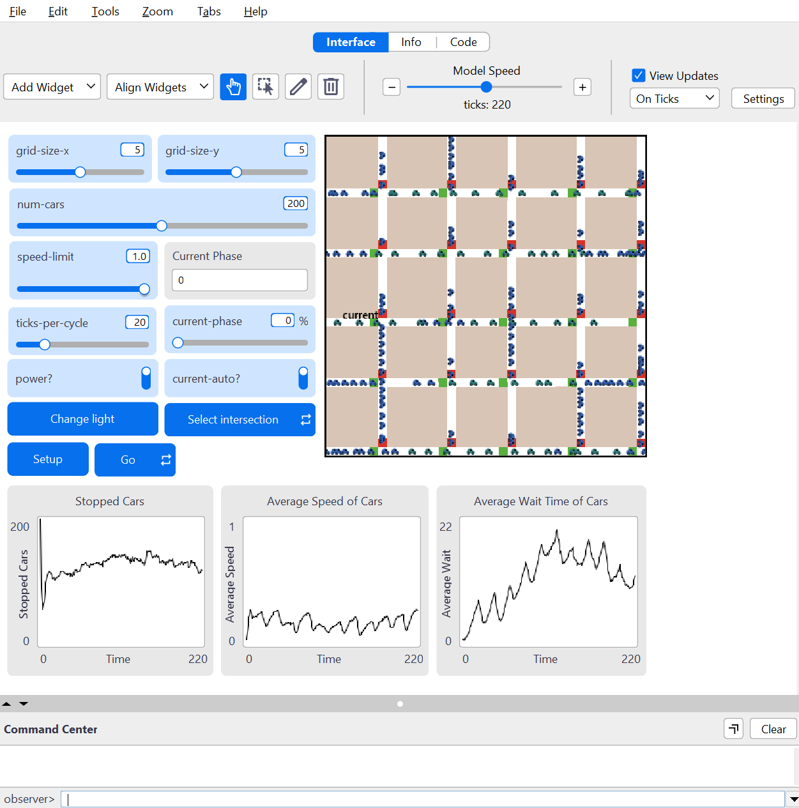
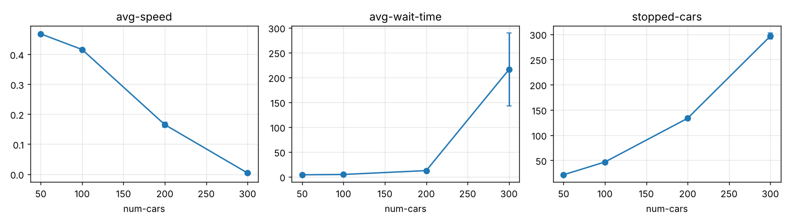
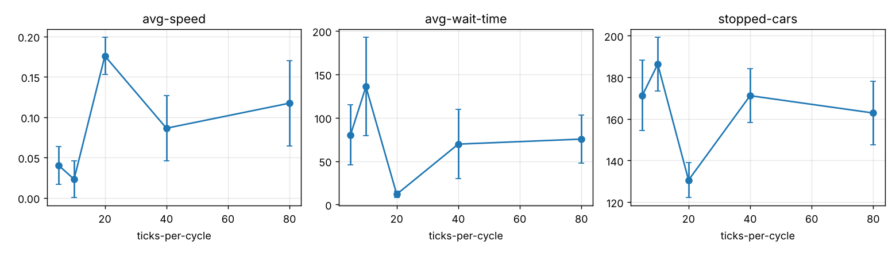
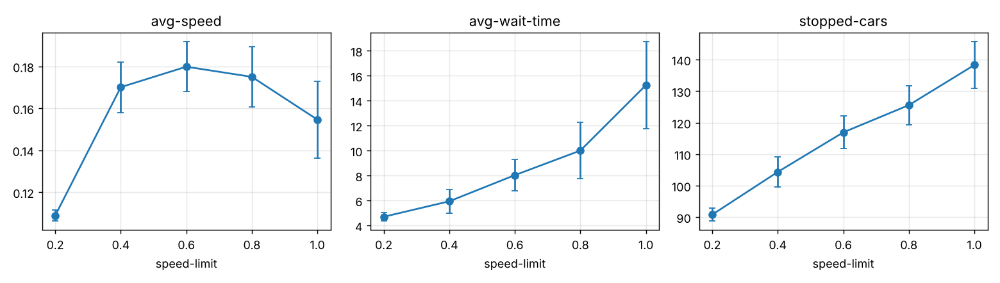

# Лабораторна робота 1

Тема: опис моделі та обчислювальні експерименти в NetLogo

Студент: Бачинський Євген Олександрович, група СПм-25-1, варіант 1

## 1. Модель

Назва: Traffic Grid (бібліотека NetLogo, Models Library -> Social Science).

Модель показує рух автомобілів по міській сітці вулиць зі світлофорами на перехрестях. Автомобілі їдуть прямо, прискорюються на вільній дорозі, пригальмовують за повільнішою машиною і зупиняються на червоний. Змінюючи кількість машин, обмеження швидкості і тривалість циклу світлофорів, можна дослідити, коли рух добрий, а коли виникають затори.

## 2. Агенти і середовище

Середовище - поле 37x37 клітинок (координати від -18 до 18), замкнене в тор. Частина клітинок - дороги (білі), решта - коричневий фон. Кількість вертикальних і горизонтальних доріг задають слайдери `grid-size-x` і `grid-size-y`. Клітинки на перетині доріг - перехрестя зі світлофором: поруч з перехрестям клітинка забарвлюється в червоний або зелений.

Агенти - автомобілі (turtles). Половина їде вниз по вертикальних дорогах, половина - праворуч по горизонтальних.

## 3. Параметри і показники

### Внутрішні параметри

- ***speed*** (змінна автомобіля) - поточна швидкість;
- ***up-car?*** - напрямок руху: так - вниз, ні - праворуч;
- ***wait-time*** - скільки тактів поспіль автомобіль стоїть;
- ***green-light-up?*** (змінна клітинки-перехрестя) - у якому напрямку зараз зелений;
- ***my-phase***, ***auto?*** - фаза перемикання світлофора та чи перемикається він автоматично;
- ***acceleration*** (глобальна) - на скільки змінюється швидкість за такт (0,099).

### Керуючі параметри

| Параметр | Значення за замовчуванням | Що означає |
|---|---|---|
| grid-size-x | 5 (від 1 до 9) | кількість вертикальних доріг |
| grid-size-y | 5 (від 1 до 9) | кількість горизонтальних доріг |
| num-cars | 200 (від 1 до 400) | кількість автомобілів |
| speed-limit | 1.0 (від 0.1 до 1) | максимальна швидкість |
| ticks-per-cycle | 20 (від 1 до 100) | тривалість циклу світлофора в тактах |
| current-phase | 0 % | у якій точці циклу перемикається обраний світлофор |
| current-auto? | увімкнено | автоматичний режим обраного світлофора |
| power? | увімкнено | чи працюють світлофори |

Кнопки: Setup, Go, Change light (змінити обраний світлофор вручну), Select intersection (обрати перехрестя).

### Показники роботи моделі

- ***stopped-cars*** (reporter для `num-cars-stopped`) - кількість автомобілів, що стоять на поточному такті (графік Stopped Cars);
- ***avg-speed*** (reporter для `mean [speed] of turtles`) - середня швидкість (графік Average Speed of Cars);
- ***avg-wait-time*** (reporter для `mean [wait-time] of turtles`) - середній час очікування (графік Average Wait Time of Cars).

## 4. Алгоритм

Початок (`setup`): будується сітка доріг і перехресть, усі світлофори отримують однакову фазу (по вертикалі зелений, по горизонталі червоний), автомобілі розставляються на вільні клітинки доріг з нульовою швидкістю.

Один такт (`go`):

1. Якщо у світлофора настав його момент у циклі (`phase`), він змінює напрямок зеленого.
2. Кожен автомобіль визначає швидкість: на червоному стоїть; якщо попереду стоїть машина або їде поперечна машина - зупиняється; якщо попереду повільніша - зменшує швидкість до її швидкості; інакше прискорюється до `speed-limit`.
3. Автомобіль їде вперед на свою швидкість, оновлюються лічильник зупинених і час очікування, колір (синій - повільно, блакитний - швидко).
4. Фаза циклу збільшується на 1, а після `ticks-per-cycle` скидається в 0.

## 5. Недоліки моделі

- Автомобілі завжди їдуть прямо й нікуди не повертають.
- Світлофор має лише два сигнали: жовтого немає, тому всі водії вважають зелений і червоний однаково.
- Усі водії однакові: однакове прискорення, однакова поведінка, поломок і аварій немає.
- Усі світлофори за замовчуванням перемикаються одночасно, тому "зеленої хвилі" немає.

## 6. Експерименти

Налаштування: BehaviorSpace, 5 повторів для кожного значення, 500 тактів, метрики `avg-speed` (середня швидкість), `avg-wait-time` (середній час очікування), `stopped-cars` (кількість зупинених машин). Значення усереднювались по тактах 100-500 (після початкового розгону), у дужках - стандартне відхилення між повторами. Решта параметрів - за замовчуванням. Експерименти описано у файлі `Traffic Grid_experiments.nlogox`, дані - `data/num_cars.csv`, `data/ticks_per_cycle.csv`, `data/speed_limit.csv`.

### Експеримент 1: num-cars

Змінюємо кількість автомобілів: 50, 100, 200, 300. Ідея: подивитися, при якій щільності руху починаються затори. Значення 400 взяти не можна: на сітці 5x5 лише 345 клітинок доріг, і при 400 машинах `setup` зупиняється з повідомленням про забагато машин (спроба з 400 дала порожні прогони, їх з даних вилучено).

Середні значення по тактах 100-500 (у дужках - стандартне відхилення між 5 повторами):

| num-cars | avg-speed | avg-wait-time | stopped-cars |
|:-:|:-:|:-:|:-:|
| 50 | 0.47 (±0.00) | 3.98 (±0.04) | 21.46 (±0.11) |
| 100 | 0.42 (±0.00) | 4.65 (±0.04) | 46.76 (±0.23) |
| 200 | 0.17 (±0.01) | 12.46 (±2.46) | 133.46 (±3.20) |
| 300 | 0.00 (±0.01) | 215.84 (±73.43) | 296.34 (±5.95) |

До 100 машин рух вільний: швидкість близько 0,4-0,5, а стоїть менше половини машин. Вже при 200 швидкість падає до 0,17 і стоїть більшість машин (133 з 200). При 300 машинах швидкість майже нуль, стоять практично всі (296 з 300), а середній час очікування сягає понад 200 тактів - це повний затор, з якого машини вже не виходять.

### Експеримент 2: ticks-per-cycle

Змінюємо тривалість циклу світлофора: 5, 10, 20, 40, 80 тактів. Ідея: перевірити, чи краще перемикати світлофори часто, чи рідко.

Середні значення по тактах 100-500 (200 машин, швидкість до 1.0):

| ticks-per-cycle | avg-speed | avg-wait-time | stopped-cars |
|:-:|:-:|:-:|:-:|
| 5 | 0.04 (±0.02) | 80.35 (±34.45) | 171.34 (±16.88) |
| 10 | 0.02 (±0.02) | 135.90 (±56.79) | 186.31 (±12.88) |
| 20 | 0.18 (±0.02) | 11.83 (±3.67) | 130.59 (±8.34) |
| 40 | 0.09 (±0.04) | 69.65 (±40.06) | 171.16 (±12.87) |
| 80 | 0.12 (±0.05) | 75.43 (±27.86) | 162.84 (±15.19) |

Найкращий результат дає цикл 20 тактів: швидкість 0,18, середнє очікування лише 12 тактів. При 5 і 10 тактах світлофори перемикаються надто часто, машини не встигають розігнатись, і виникає затор (швидкість 0,02-0,04, очікування 80-136 тактів). При 40 і 80 тактах результат теж гірший, а розкид між повторами великий: в одних прогонах затор виникає, в інших ні. Але повторів лише 5, тому конкретне значення 20 як найкраще треба сприймати обережно.

### Експеримент 3: speed-limit

Змінюємо обмеження швидкості: 0.2, 0.4, 0.6, 0.8, 1.0.

Середні значення по тактах 100-500 (200 машин, цикл 20 тактів):

| speed-limit | avg-speed | avg-wait-time | stopped-cars |
|:-:|:-:|:-:|:-:|
| 0.2 | 0.11 (±0.00) | 4.70 (±0.33) | 90.81 (±1.99) |
| 0.4 | 0.17 (±0.01) | 5.94 (±0.93) | 104.35 (±4.85) |
| 0.6 | 0.18 (±0.01) | 8.04 (±1.25) | 116.92 (±5.20) |
| 0.8 | 0.17 (±0.01) | 10.01 (±2.27) | 125.56 (±6.17) |
| 1 | 0.15 (±0.02) | 15.25 (±3.47) | 138.30 (±7.35) |

Середня швидкість спочатку росте (від 0,11 до 0,18 при обмеженні 0.6), але далі трохи падає до 0,15 при 1.0. При цьому зі зростанням обмеження збільшуються і кількість зупинених машин (від 91 до 138), і час очікування (від 4,7 до 15,3). Швидші машини ближче підʼїжджають до червоного і утворюють довші черги, тому більше обмеження не означає кращий рух.

## Висновки

Найсильніше на рух впливає кількість машин: до 100 машин на сітці 5x5 рух вільний, при 200 з'являються великі черги, а при 300 виникає повний затор. Тривалість циклу світлофора теж важлива: у цих експериментах найкраще працював цикл 20 тактів, а дуже короткі (5 і 10) і дуже довгі (40 і 80) цикли давали гірший рух. Підвищення обмеження швидкості не покращує рух, а при великому обмеженні навіть збільшує черги. Недолік експериментів - лише 5 повторів, а за певних налаштувань результат сильно залежить від випадкового початкового розташування машин.
