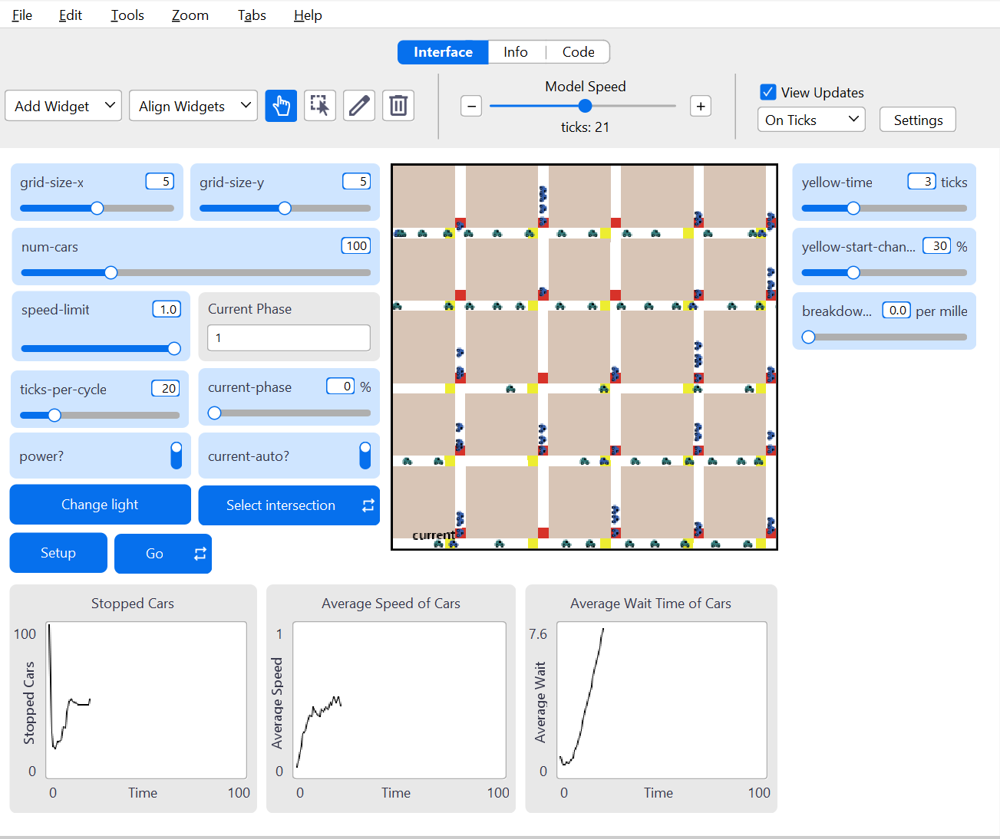
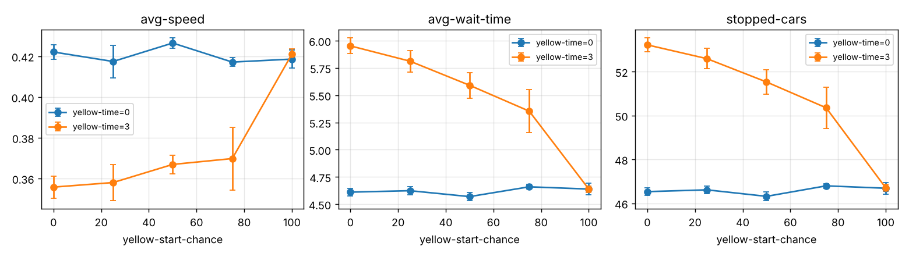
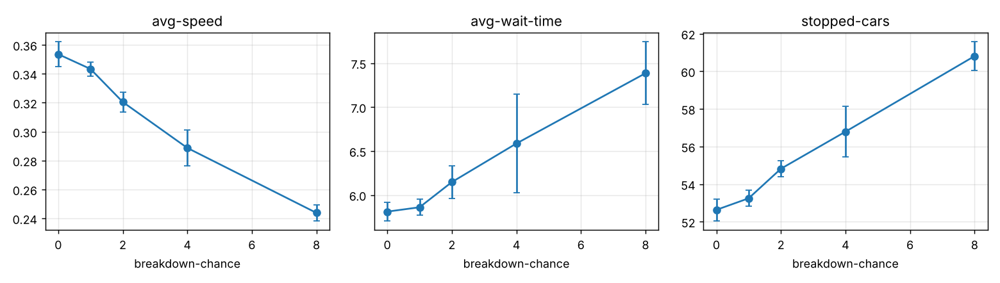

# Лабораторна робота 2

Тема: зміна логіки моделі NetLogo

Студент: Бачинський Євген Олександрович, група СПм-25-1, варіант 1

Модель: Traffic Grid (NetLogo), файл `Traffic Grid_modified.nlogox`.

## 1. Завдання

Зміни за варіантом 1:

- додати жовтий сигнал світлофорів;
- додати ймовірність того, що водії починають рух не тільки на зелений, а й на жовтий.

Власна зміна: випадкові поломки автомобілів (параметр `breakdown-chance`).

## 2. Зміни в коді

### Нові змінні та елементи інтерфейсу

Автомобіль отримав змінні `risky?` (чи їде водій на жовтий) і `stalled` (скільки тактів ще стоїть зламана машина). Перехрестя отримало змінну `yellow-left` (скільки тактів лишилось до кінця жовтого сигналу). На вкладці Interface додано слайдери:

| Слайдер | Значення за замовчуванням | Призначення |
|---|---|---|
| yellow-time | 3 такти (від 0 до 10) | тривалість жовтого сигналу; 0 - як у початковій моделі |
| yellow-start-chance | 30 % (від 0 до 100) | частка водіїв, які їдуть на жовтий |
| breakdown-chance | 0 (від 0 до 10, крок 0.5) | ймовірність поломки автомобіля на такті, в проміле |

Інтерфейс зміненої моделі (на перехрестях видно жовтий сигнал):



### Зміна 1: жовтий сигнал

Коли настає момент перемикання, світлофор не змінює напрямок одразу: сторона, що мала зелений, спершу жовтіє на `yellow-time` тактів, інша сторона лишається червоною. Коли жовтий закінчується, напрямки міняються. Якщо `yellow-time` = 0, світлофор працює як раніше.

``` NetLogo
;; have the traffic lights change color if phase equals each intersections' my-phase
to set-signals
  ask intersections with [auto? and yellow-left = 0 and phase = floor ((my-phase * ticks-per-cycle) / 100)]
  [
    ifelse yellow-time > 0
    [
      ;; the green side turns yellow first, the other side stays red
      set yellow-left yellow-time
      set-signal-colors
    ]
    [
      set green-light-up? (not green-light-up?)
      set-signal-colors
    ]
  ]
end

;; count the yellow phase down and switch the signal when it ends
to update-yellow
  ask intersections with [yellow-left > 0]
  [
    set yellow-left yellow-left - 1
    if yellow-left = 0
    [
      set green-light-up? (not green-light-up?)
      set-signal-colors
    ]
  ]
end

;; This procedure checks the variable green-light-up? at each intersection and sets the
;; traffic lights to have the green light up or the green light to the left.
to set-signal-colors  ;; intersection (patch) procedure
  ifelse power?
  [
    let go-color ifelse-value (yellow-left > 0) [ yellow ] [ green ]
    ifelse green-light-up?
    [
      ask patch-at -1 0 [ set pcolor red ]
      ask patch-at 0 1 [ set pcolor go-color ]
    ]
    [
      ask patch-at -1 0 [ set pcolor go-color ]
      ask patch-at 0 1 [ set pcolor red ]
    ]
  ]
  [
    ask patch-at -1 0 [ set pcolor white ]
    ask patch-at 0 1 [ set pcolor white ]
  ]
end
```

### Зміна 2: водії на жовтий

Під час `setup` кожен водій отримує ознаку `risky?`: вона істинна з ймовірністю `yellow-start-chance` %. Обережні водії на жовтому стоять, як на червоному, ризикові - їдуть за звичайними правилами. Тому зміна `yellow-start-chance` впливає лише після натискання Setup.

``` NetLogo
;; set the turtles' speed based on whether they are at a red traffic light or the speed of the
;; turtle (if any) on the patch in front of them
to set-car-speed  ;; turtle procedure
  ;; random breakdown: the car stands still for 10 ticks
  if stalled = 0 and random-float 1000 < breakdown-chance [ set stalled 10 ]
  ifelse stalled > 0
  [
    set stalled stalled - 1
    set speed 0
  ]
  [
    ;; red stops everybody, yellow stops only the careful drivers
    ifelse pcolor = red or (pcolor = yellow and not risky?)
    [ set speed 0 ]
    [
      ifelse up-car?
      [ set-speed 0 -1 ]
      [ set-speed 1 0 ]
    ]
  ]
end
```

У `setup-cars` додано два рядки:

``` NetLogo
  set stalled 0
  set risky? random-float 100 < yellow-start-chance
```

### Зміна 3 (власна): поломки автомобілів

На кожному такті автомобіль ламається з імовірністю `breakdown-chance` / 1000 і стоїть 10 тактів (код вже входить у `set-car-speed` вище). Зламана машина блокує дорогу, тому ззаду утворюється затор.

## 3. Експерименти

Налаштування: BehaviorSpace, 5 повторів, 500 тактів, метрики `avg-speed` (середня швидкість), `avg-wait-time` (середній час очікування), `stopped-cars` (кількість зупинених машин), усереднення по тактах 100-500. У всіх експериментах `num-cars` = 100: при 200 машинах (значення за замовчуванням) рух на сітці 5x5 нестійкий і результати занадто залежать від випадку (ЛР1). Експерименти збережено у `Traffic Grid_modified.nlogox`, дані (CSV) - поруч зі звітом, графіки - у папці `images`.

### Експеримент 1: водії на жовтий

Змінюємо `yellow-start-chance` (0, 25, 50, 75, 100 %) для двох режимів: `yellow-time` = 0 (жовтого немає, початкова модель) і `yellow-time` = 3. Решта - за замовчуванням, `breakdown-chance` = 0, `num-cars` = 100. Ідея: перевірити, чи втрачає потік через жовтий сигнал і чи повертають втрачене ризикові водії.

Середні значення по тактах 100-500 (у дужках - стандартне відхилення між 5 повторами):

| yellow-time | yellow-start-chance | avg-speed | avg-wait-time | stopped-cars |
|:-:|:-:|:-:|:-:|:-:|
| 0 | 0 | 0.42 (±0.00) | 4.61 (±0.03) | 46.53 (±0.17) |
| 0 | 25 | 0.42 (±0.01) | 4.62 (±0.04) | 46.61 (±0.17) |
| 0 | 50 | 0.43 (±0.00) | 4.57 (±0.04) | 46.32 (±0.19) |
| 0 | 75 | 0.42 (±0.00) | 4.66 (±0.02) | 46.79 (±0.11) |
| 0 | 100 | 0.42 (±0.00) | 4.64 (±0.05) | 46.69 (±0.27) |
| 3 | 0 | 0.36 (±0.01) | 5.95 (±0.07) | 53.22 (±0.32) |
| 3 | 25 | 0.36 (±0.01) | 5.81 (±0.10) | 52.59 (±0.47) |
| 3 | 50 | 0.37 (±0.00) | 5.59 (±0.12) | 51.53 (±0.56) |
| 3 | 75 | 0.37 (±0.02) | 5.35 (±0.20) | 50.35 (±0.94) |
| 3 | 100 | 0.42 (±0.00) | 4.64 (±0.03) | 46.71 (±0.15) |

Без жовтого сигналу (`yellow-time` = 0) рух не залежить від `yellow-start-chance`: швидкість 0,42 і близько 46,5 зупинених машин у всіх рядках (різниця лише в межах розкиду). З жовтим сигналом, коли всі водії обережні, швидкість падає до 0,36, а зупинених машин стає 53: приблизно на 14 % гірше, бо жовтий додає час, коли ніхто не їде. Чим більше ризикових водіїв, тим менша втрата: при 50 % швидкість 0,37, при 75 % 0,37, а при 100 % повертається до 0,42, тобто рівно до рівня без жовтого сигналу.




### Експеримент 2: поломки

Змінюємо `breakdown-chance`: 0, 1, 2, 4, 8 проміле. Решта: `yellow-time` = 3, `yellow-start-chance` = 30 %, `num-cars` = 100.

Середні значення по тактах 100-500 (жовтий 3 такти, 30 % ризикових водіїв):

| breakdown-chance | avg-speed | avg-wait-time | stopped-cars |
|:-:|:-:|:-:|:-:|
| 0 | 0.35 (±0.01) | 5.81 (±0.11) | 52.63 (±0.59) |
| 1 | 0.34 (±0.00) | 5.86 (±0.09) | 53.24 (±0.42) |
| 2 | 0.32 (±0.01) | 6.15 (±0.19) | 54.82 (±0.44) |
| 4 | 0.29 (±0.01) | 6.59 (±0.56) | 56.79 (±1.34) |
| 8 | 0.24 (±0.01) | 7.38 (±0.36) | 60.81 (±0.76) |

Чим частіше ламаються машини, тим гірший рух: швидкість падає від 0,35 без поломок до 0,24 при 8 проміле, зупинених машин стає 61 замість 53, а час очікування росте з 5,8 до 7,4 такту. Зламана машина стоїть 10 тактів і блокує дорогу, тому за нею утворюється черга. Уже при 1-2 проміле зміна невелика, помітно гірше стає від 4 проміле.




## Висновки

Жовтий сигнал робить рух повільнішим: швидкість падає з 0,42 до 0,36, бо водії-обережні зупиняються, а проїхати на жовтий вони не можуть. Якщо частина водіїв їде на жовтий, втрата зменшується, а коли їдуть усі, рух такий самий, як без жовтого. Випадкові поломки погіршують рух тим сильніше, чим вони частіші: при 8 проміле швидкість падає приблизно на третину. Недолік моделі: водій їде на жовтий завжди однаково, без урахування відстані до перехрестя.
