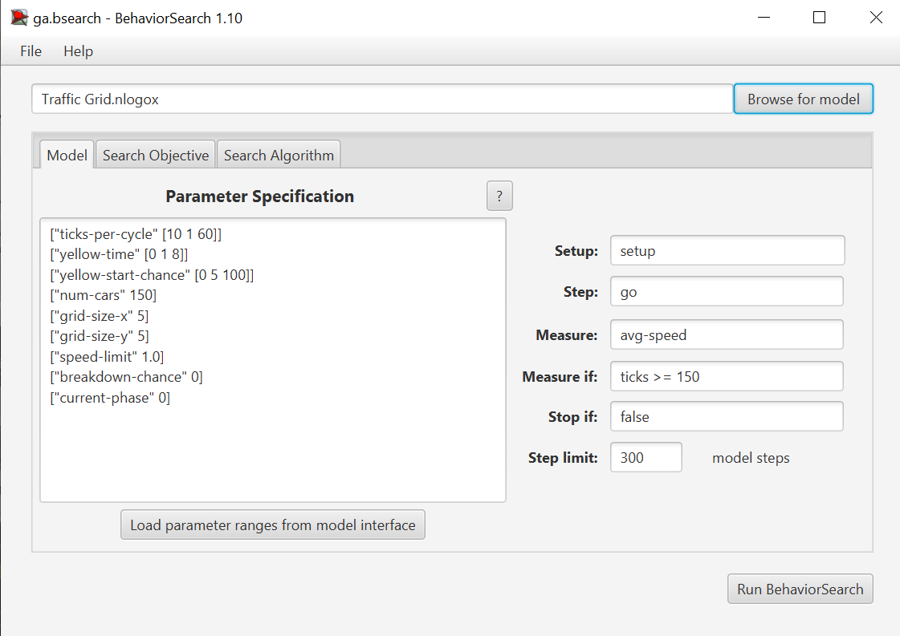
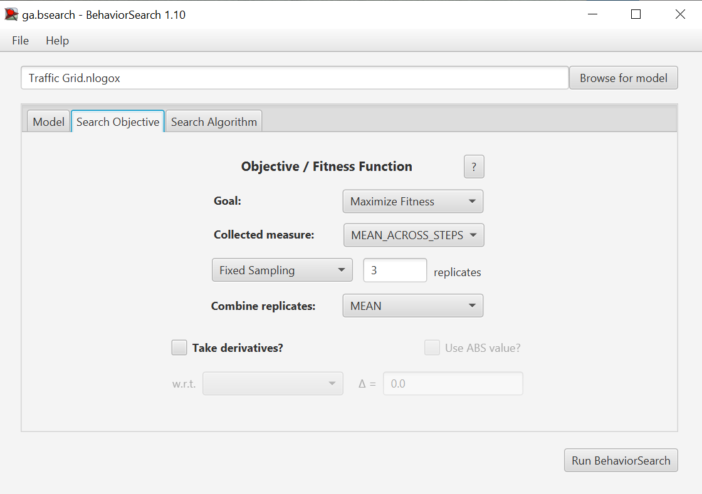
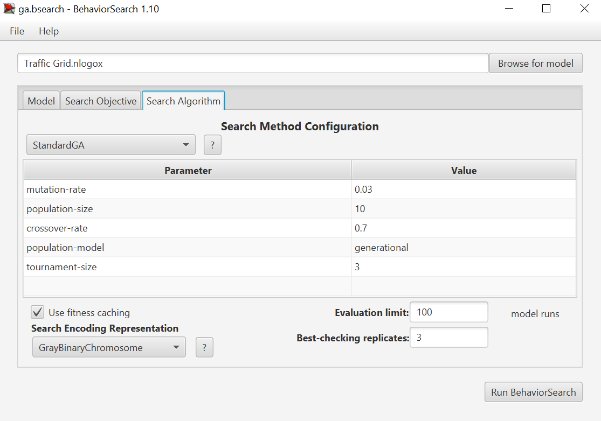
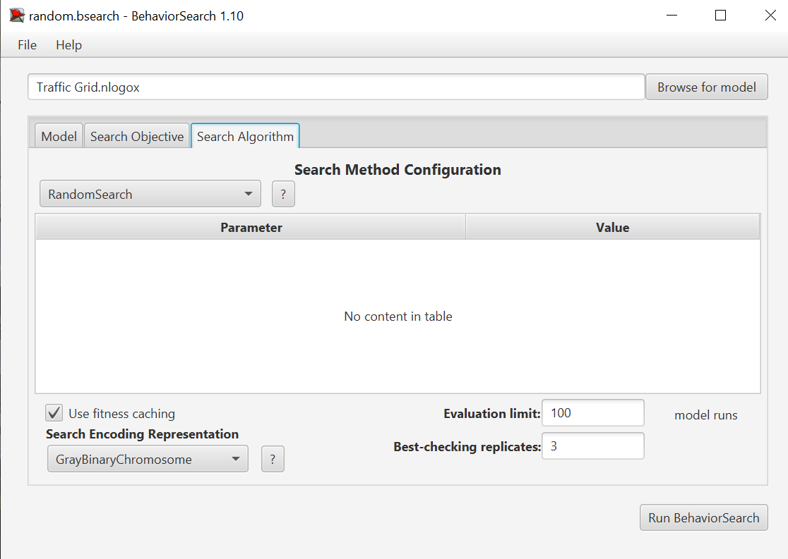
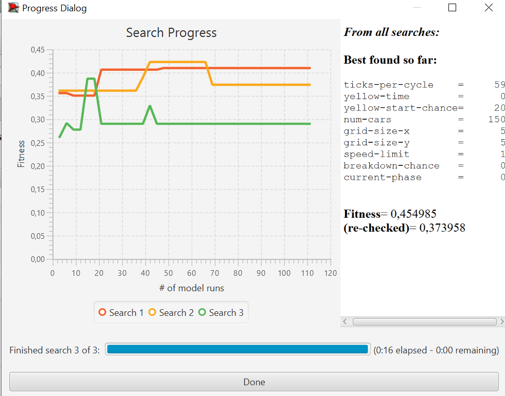
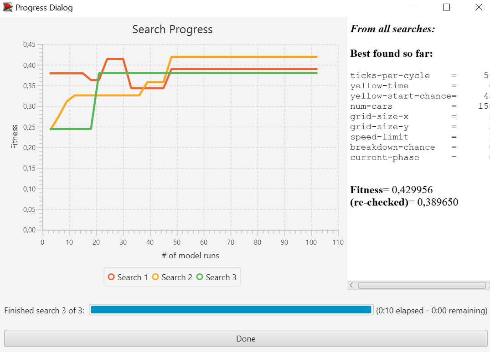
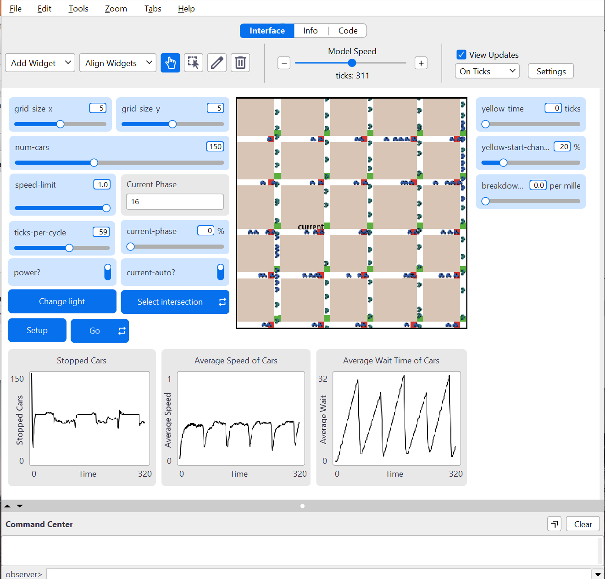

# Лабораторна робота 3

Тема: пошук параметрів моделі в BehaviorSearch

Студент: Бачинський Євген Олександрович, група СПм-25-1, варіант 1

## 1. Мета пошуку

Модель: Traffic Grid у версії з другої лабораторної (`Traffic Grid.nlogox`, NetLogo 7, BehaviorSearch 1.10).

Мета - підібрати параметри світлофорів, при яких середня швидкість автомобілів найбільша. Цільова функція (максимізується) - середня швидкість усіх машин. Вона записана як окремий репортер моделі `avg-speed` (BehaviorSearch не завжди бачить змінні моделі напряму, тому показник винесено в репортер):

```
to-report avg-speed
  report mean [speed] of turtles
end
```

Вона вимірюється на кожному такті після 150-го (`ticks >= 150`), коли рух вже розігнався, і усереднюється (MEAN_ACROSS_STEPS). Для обох методів пошуку функція однакова.

## 2. Налаштування

Вкладка Model (параметри, показник, умови вимірювання):



Вкладка Search Objective (цільова функція):



Налаштування генетичного алгоритму:



Налаштування випадкового пошуку:



Керуючі параметри (простір пошуку):

| Параметр | Діапазон | Крок |
|---|---|---|
| ticks-per-cycle | 10 - 60 | 1 |
| yellow-time | 0 - 8 | 1 |
| yellow-start-chance | 0 - 100 | 5 |

Сталі параметри: `num-cars` = 150, `grid-size-x` = `grid-size-y` = 5, `speed-limit` = 1.0, `breakdown-chance` = 0, `current-phase` = 0. Кількість машин зафіксовано, бо при меншій кількості швидкість зростає сама по собі. Значення 150 взято між вільним рухом (100 машин) і заторами (200 і більше), щоб налаштування світлофорів справді впливали на результат.

Метод 1: генетичний алгоритм (StandardGA): розмір популяції 10, mutation-rate 0.03, crossover-rate 0.7, tournament-size 3, generational, кодування GrayBinaryChromosome. Метод 2: випадковий пошук (RandomSearch).

| Налаштування | Значення |
|---|---|
| Evaluation limit | 100 запусків моделі |
| Повторів пошуку для кожного методу | 3 |
| Повторів моделі для однієї оцінки (fitness sampling) | 3 |
| Best-checking replicates | 3 |
| Кроків моделі (step limit) | 300 |
| Stop if | false |

Файли налаштувань: `ga.bsearch`, `random.bsearch`. Результати пошуку (найкращі комбінації кожного запуску): `ga.finalBests.csv`, `ga.finalCheckedBests.csv`, `random.finalBests.csv`, `random.finalCheckedBests.csv`.

## 3. Результати

Найкраща комбінація кожного з трьох запусків (середня швидкість, більше - краще). Колонка «Перевірка» - значення, яке дав Best-checking (3 нових прогони з тими самими параметрами):

**Генетичний алгоритм**

| Запуск | ticks-per-cycle | yellow-time | yellow-start-chance | Оцінок моделі | Швидкість при пошуку | Перевірка |
|:-:|:-:|:-:|:-:|:-:|:-:|:-:|
| 1 | 55 | 1 | 70 | 111 | 0.412 | 0.410 |
| 2 | 59 | 0 | 20 | 111 | 0.455 | 0.374 |
| 3 | 50 | 4 | 15 | 111 | 0.395 | 0.290 |
| Середнє | | | | | 0.421 | 0.358 |

**Випадковий пошук**

| Запуск | ticks-per-cycle | yellow-time | yellow-start-chance | Оцінок моделі | Швидкість при пошуку | Перевірка |
|:-:|:-:|:-:|:-:|:-:|:-:|:-:|
| 1 | 56 | 0 | 45 | 102 | 0.430 | 0.390 |
| 2 | 52 | 1 | 60 | 102 | 0.413 | 0.419 |
| 3 | 51 | 0 | 20 | 102 | 0.413 | 0.380 |
| Середнє | | | | | 0.419 | 0.396 |

Графіки з BehaviorSearch (кожна лінія - один запуск пошуку). Генетичний алгоритм:



Випадковий пошук:



## 4. Перевірка знайдених параметрів

Для перевірки в NetLogo задано параметри найкращого розв'язку генетичного алгоритму (запуск 2): `ticks-per-cycle` 59, `yellow-time` 0, `yellow-start-chance` 20, `num-cars` 150, інші параметри за замовчуванням. Графік швидкості після 300 тактів:



На такті 311 графік швидкості (Average Speed of Cars) тримається приблизно на рівні 0.4-0.5 з короткими провалами раз на цикл світлофора (59 тактів), коли сигнали перемикаються. Це збігається з результатом пошуку: середня швидкість при цих параметрах близько 0.37-0.45.

## Висновки

Обидва методи прийшли до схожих параметрів: довгий цикл світлофора (50-59 тактів) і жовтий сигнал 0-1 такт, при цьому середня швидкість 0.41-0.45. Найгірші комбінації (швидкість близько 0.06) мали короткий цикл 10-11 тактів і довгий жовтий 7-8 тактів. Явного переможця немає: під час пошуку методи майже рівні (0.421 проти 0.419), а за перевіркою випадковий пошук трохи кращий (0.396 проти 0.358). Генетичний алгоритм у запуску 3 застряг на комбінації з жовтим 4 такти (перевірка 0.290), тому з трьох запусків середнє в нього гірше. Генетичний алгоритм не виявився швидшим: обидва методи за 100 оцінок дійшли до одного рівня, бо простір параметрів невеликий і випадковий пошук легко влучає в хороші значення. Недолік: оцінка швидкості залежить від випадковості моделі, тому різниця 0.36 і 0.40 лежить у межах розкиду.
