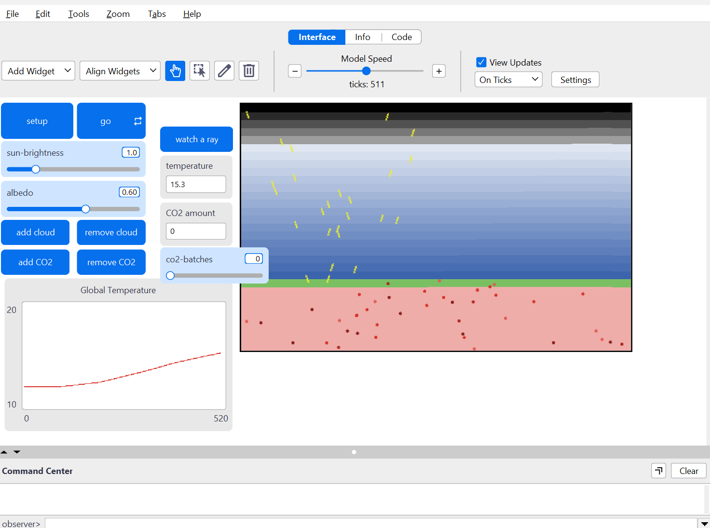
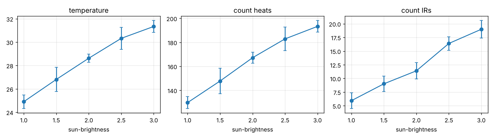
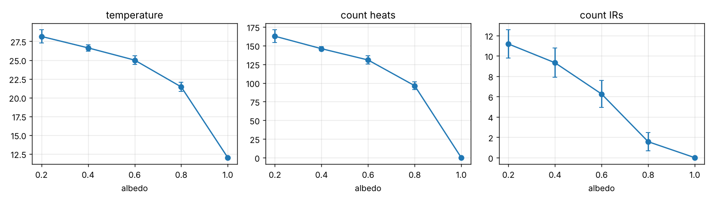
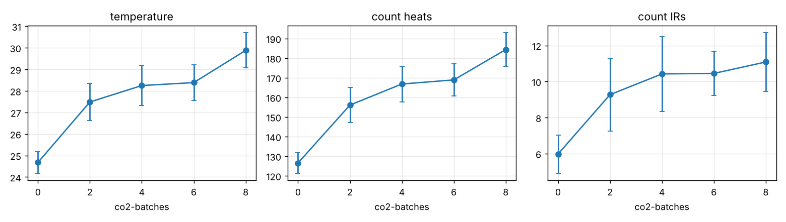

# Лабораторна робота 1

Тема: опис моделі та обчислювальні експерименти в NetLogo

Студент: Бачинський Євген Олександрович, група СПм-25-1, варіант 2

## 1. Модель

Назва: Climate Change (бібліотека NetLogo, Models Library -> Earth Science).

Модель показує, як тепло потрапляє на Землю і залишає її. Сонячні промені нагрівають поверхню планети, нагріта поверхня випромінює інфрачервоне (ІЧ) світло в космос, а хмари та молекули CO2 заважають цьому потоку. Від балансу між енергією, що прийшла, і енергією, що пішла, залежить температура Землі. На моделі зручно побачити парниковий ефект: чим більше CO2, тим більше ІЧ-випромінювання повертається назад і тим тепліше стає.

## 2. Агенти і середовище

Середовище - поле 49x31 клітинок (x від -24 до 24, y від -8 до 22), по горизонталі замкнене в тор. Воно поділене на шари: земля (нижні рядки), поверхня Землі (y = 0, колір залежить від альбедо), атмосфера (синя) і космос (верхні п'ять рядків).

Агенти (breed):

- **rays** - пакети сонячного світла (жовті), летять вниз;
- **heats** - пакети тепла (червоні), рухаються всередині Землі після поглинання променя;
- **IRs** - пакети інфрачервоного випромінювання (пурпурні), летять угору;
- **CO2s** - молекули вуглекислого газу (зелені), блукають по атмосфері;
- **clouds** - хмари; кожна хмара складається з кількох черепашок з однаковим `cloud-id` і швидкістю `cloud-speed`.

## 3. Параметри і показники

### Внутрішні параметри

- ***temperature*** - глобальна змінна, температура Землі (початкове значення 12);
- ***sky-top*** і ***earth-top*** - висота верху атмосфери і рівень поверхні Землі;
- ***cloud-speed***, ***cloud-id*** - швидкість і номер хмари;
- ймовірності та кроки в коді: промінь рухається на 0,3 клітинки за такт; новий промінь з'являється з ймовірністю `10 * sun-brightness / 50` на такт; пакет тепла виходить з Землі як ІЧ тим частіше, чим вища температура.

### Керуючі параметри

| Параметр | Значення за замовчуванням | Що означає |
|---|---|---|
| sun-brightness | 1.0 (від 0 до 5, крок 0.2) | яскравість Сонця: скільки променів надходить на Землю |
| albedo | 0.6 (від 0 до 1, крок 0.05) | яка частина сонячної енергії відбивається поверхнею |
| кнопки add cloud / remove cloud | - | додають або прибирають одну хмару |
| кнопки add CO2 / remove CO2 | - | додають або прибирають 25 молекул CO2 |
| co2-batches | 0 (від 0 до 10) | допоміжний слайдер для експерименту: скільки разів виконати `add-CO2` після `setup` (25 молекул за раз) |

Слайдер `co2-batches` додано лише у файл з експериментами, оскільки в оригіналі кількість CO2 змінюється тільки кнопкою, а BehaviorSpace не може її натискати. Код моделі при цьому не змінювався.

### Показники роботи моделі

- ***temperature*** - температура Землі (монітор і графік Global Temperature);
- ***count CO2s*** - кількість молекул CO2 (монітор CO2 amount);
- ***count heats*** - кількість пакетів тепла в Землі; температура прямо залежить від цього числа;
- ***count IRs*** - кількість ІЧ-пакетів, що зараз летять до космосу.

## 4. Алгоритм

Початок (`setup`): очищується світ, малюються шари, температура стає рівною 12.

Один такт (`go`):

1. Хмари зміщуються вправо на свою швидкість.
2. Промені рухаються вниз; ті, що дійшли до краю світу, зникають. З певною ймовірністю з'являється новий промінь у верхньому лівому куті. Якщо промінь потрапив у клітинку з хмарою, він розвертається. Якщо промінь дійшов до поверхні Землі, то з імовірністю `albedo` відбивається, інакше поглинається й стає пакетом тепла.
3. Температура підтягується до значення `12 + 0,1 * (кількість пакетів тепла)` (кожен такт 1 % різниці).
4. Пакети тепла хаотично рухаються. Біля поверхні пакет може вийти з Землі як ІЧ, але лише якщо температура вища за 20 градусів (чим вища, тим імовірніше), інакше він повертається вглиб.
5. ІЧ-пакети летять угору; якщо зустрічають молекулу CO2 - відбиваються назад, а діставшись до поверхні знову стають теплом. Хмари ІЧ не затримують.
6. Молекули CO2 повільно блукають атмосферою.

## 5. Недоліки моделі

- На початку немає ні хмар, ні CO2: їх можна додати тільки кнопками вже після `setup`.
- Сонце завжди світить з однієї точки під одним кутом, тому доби і зміни пір року немає.
- Хмара відбиває промінь абсолютно завжди, а альбедо однакове по всій поверхні.
- Температура Землі одна на всю планету, моря й льодовиків немає.

## 6. Експерименти

Налаштування: BehaviorSpace, 5 повторів для кожного значення, 3000 тактів, метрики `temperature`, `count heats`, `count IRs`. Значення усереднювались по тактах 2500-3000 (коли температура вже майже перестала рости), у дужках - стандартне відхилення між повторами. Решта параметрів - за замовчуванням, хмар немає, CO2 немає. Експерименти описано у файлі `Climate Change_experiments.nlogox`, дані - `data/sun_brightness.csv`, `data/albedo.csv`, `data/co2_amount.csv`.

### Експеримент 1: sun-brightness

Змінюємо яскравість Сонця: 1.0, 1.5, 2.0, 2.5, 3.0. Ідея: з'ясувати, наскільки температура залежить від кількості сонячної енергії.

Середні значення по тактах 2500-3000 (у дужках - стандартне відхилення між 5 повторами):

| sun-brightness | temperature | count heats | count IRs |
|:-:|:-:|:-:|:-:|
| 1 | 24.91 (±0.58) | 129.78 (±4.91) | 5.93 (±1.43) |
| 1.5 | 26.81 (±1.04) | 147.78 (±10.73) | 9.02 (±1.41) |
| 2 | 28.62 (±0.34) | 167.18 (±4.53) | 11.39 (±1.48) |
| 2.5 | 30.32 (±0.93) | 182.90 (±9.75) | 16.40 (±1.24) |
| 3 | 31.34 (±0.51) | 193.33 (±4.86) | 19.00 (±1.60) |

При зростанні яскравості Сонця температура росте від 24,9 до 31,3 градуса, а кількість пакетів тепла - від 130 до 193. Приріст з кожним кроком менший: від 1.0 до 1.5 температура зростає майже на 2 градуси, а від 2.5 до 3.0 - трохи більше ніж на 1. Гарячіша Земля швидше віддає тепло ІЧ-випромінюванням, тому нагрів сповільнюється.

### Експеримент 2: albedo

Змінюємо альбедо: 0.2, 0.4, 0.6, 0.8, 1.0. Ідея: перевірити, як відбивна здатність поверхні впливає на температуру.

Середні значення по тактах 2500-3000:

| albedo | temperature | count heats | count IRs |
|:-:|:-:|:-:|:-:|
| 0.2 | 28.16 (±0.88) | 162.59 (±8.53) | 11.17 (±1.39) |
| 0.4 | 26.63 (±0.41) | 145.88 (±2.65) | 9.33 (±1.44) |
| 0.6 | 25.00 (±0.58) | 130.75 (±5.50) | 6.26 (±1.33) |
| 0.8 | 21.43 (±0.62) | 96.30 (±5.27) | 1.57 (±0.91) |
| 1 | 12.00 (±0.00) | 0.00 (±0.00) | 0.00 (±0.00) |

Чим більше альбедо, тим холодніше: від 28,2 градуса при 0.2 до 21,4 при 0.8. При альбедо 1.0 поверхня відбиває все світло, тепло не утворюється взагалі, і температура лишається на початковому рівні 12 градусів. При альбедо 0.8 температура до 3000-го такта ще повільно росла (від 20,8 на 2500-му до 21,9 на 3000-му), тому її стале значення могло бути трохи вищим.

### Експеримент 3: кількість CO2

Змінюємо кількість молекул CO2: 0, 50, 100, 150, 200 (`co2-batches` = 0, 2, 4, 6, 8). Ідея: подивитися, як парниковий ефект змінює температуру.

Середні значення по тактах 2500-3000:

| CO2 (co2-batches) | temperature | count heats | count IRs |
|:-:|:-:|:-:|:-:|
| 0 (0) | 24.67 (±0.50) | 126.50 (±5.22) | 5.97 (±1.07) |
| 50 (2) | 27.48 (±0.85) | 156.04 (±8.91) | 9.27 (±2.03) |
| 100 (4) | 28.24 (±0.93) | 166.79 (±9.09) | 10.42 (±2.08) |
| 150 (6) | 28.38 (±0.82) | 168.87 (±8.24) | 10.45 (±1.22) |
| 200 (8) | 29.88 (±0.82) | 184.34 (±8.55) | 11.08 (±1.62) |

Додавання CO2 підвищує температуру: від 24,7 градуса без CO2 до 29,9 при 200 молекулах. Найбільший стрибок дають перші 50 молекул (майже 3 градуси), далі приріст повільніший. Через розкид між повторами (близько ±0,8) різницю між 100 і 150 молекулами від шуму відрізнити не можна. Для великої кількості CO2 температура наприкінці прогону ще не встигла повністю встановитись.

## Висновки

У всіх експериментах температура спочатку росте з 12 градусів, а потім виходить на майже стабільний рівень, тому прогони тривають 3000 тактів. Яскравість Сонця і альбедо змінюють температуру приблизно однаково сильно (на 6-7 градусів у діапазонах від 1.0 до 3.0 і від 0.2 до 0.8), але з ростом яскравості ефект слабшає, а при альбедо 1.0 температура падає до початкових 12 градусів. Більше CO2 робить Землю теплішою приблизно на 5 градусів (від 0 до 200 молекул), бо молекули повертають ІЧ-випромінювання назад. Незвичне значення одне: при альбедо 1.0 Земля не нагрівається взагалі. Також ІЧ вилітає лише при температурі вище 20 градусів, тому до цієї межі CO2 майже не впливає, а нагрів іде повільно.
