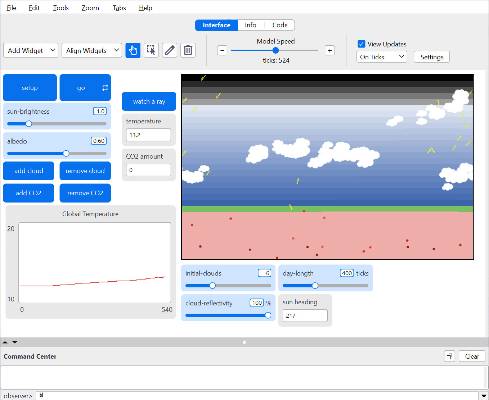
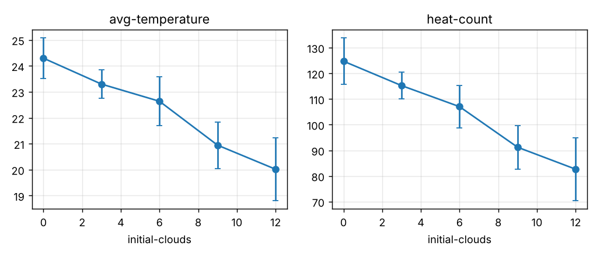
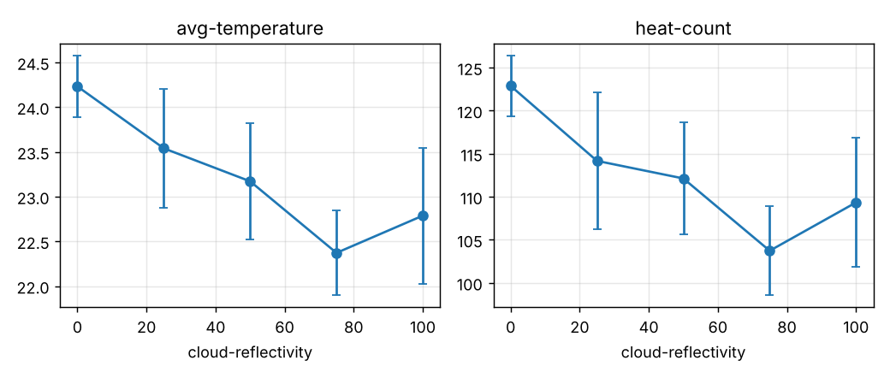

# Лабораторна робота 2

Тема: зміна логіки моделі NetLogo

Студент: Бачинський Євген Олександрович, група СПм-25-1, варіант 2

Модель: Climate Change (NetLogo), файл `Climate Change_modified.nlogox`.

## 1. Завдання

Зміни за варіантом 2:

- додати можливість вказувати початкову кількість хмар;
- додати зміну кута падіння нових сонячних променів з часом (імітація руху Сонця протягом доби).

Власна зміна: хмара відбиває промінь не завжди, а з заданою ймовірністю (параметр `cloud-reflectivity`).

## 2. Зміни в коді

### Нові елементи інтерфейсу

| Елемент | Значення за замовчуванням | Призначення |
|---|---|---|
| initial-clouds | 0 (від 0 до 20) | кількість хмар, що створюються в `setup` |
| day-length | 400 тактів (від 50 до 1000) | тривалість "доби" в тактах |
| cloud-reflectivity | 100 % (від 0 до 100) | ймовірність, що хмара відбиває промінь |
| монітор sun heading | - | поточний напрямок променів |

Значення за замовчуванням `initial-clouds` = 0 і `cloud-reflectivity` = 100 залишають хмарну логіку такою, як у початковій моделі. Сонце тепер рухається завжди, як вимагає завдання.

Інтерфейс зміненої моделі (6 хмар, 524-й такт):



### Зміна 1: початкові хмари

У `setup` після створення світу викликається вже наявна процедура `add-cloud` потрібну кількість разів.

``` NetLogo
to setup
  ...
  setup-world
  repeat initial-clouds [ add-cloud ]  ;; clouds at the start
  set temperature 12
  reset-ticks
end
```

### Зміна 2: рух Сонця

Напрямок променів тепер обчислює окремий репортер `sun-heading`: протягом доби він змінюється за синусом від 140 до 220 градусів (180 - промені падають прямо вниз). Коли Сонце низько, кожен промінь несе менше енергії на одиницю площі, тому ймовірність створення променя множиться на косинус відхилення від вертикалі.

``` NetLogo
to-report sun-heading
  ;; the sun moves from east to west during a "day" of day-length ticks
  report 180 + 40 * sin (360 * ticks / day-length)
end

to create-sunshine
  let h sun-heading
  ;; a low sun gives less energy per ray, so the ray chance falls with the angle
  let k cos (h - 180)
  if 10 * sun-brightness * k > random 50 [
    create-rays 1 [
      set heading h
      set color yellow
      ;; rays only come from a small area
      ;; near the top of the world
      setxy (random 10) + min-pxcor max-pycor
    ]
  ]
end
```

### Зміна 3 (власна): ймовірність відбиття хмарою

У початковій моделі хмара розвертала кожен промінь, що потрапив в її клітинку. Тепер це відбувається з ймовірністю `cloud-reflectivity` %, тож хмари можуть бути "тонкими" й частково пропускати світло.

``` NetLogo
to reflect-rays-from-clouds
  ;; a cloud reflects a ray only with probability cloud-reflectivity (%)
  ask rays with [any? clouds-here and random 100 < cloud-reflectivity] [
    set heading 180 - heading
  ]
end
```

## 3. Експерименти

Налаштування: BehaviorSpace, 5 повторів, 3000 тактів (температура доходить до майже сталого рівня лише після ~2500 тактів), метрики `avg-temperature` (reporter для `temperature`) і `heat-count` (reporter для `count heats`), усереднення по тактах 2600-3000 (рівно одна "доба" при `day-length` = 400). Експерименти збережено у `Climate Change_modified.nlogox`, дані (CSV) - поруч зі звітом, графіки - у папці `images`.

### Експеримент 1: початкова кількість хмар

Змінюємо `initial-clouds`: 0, 3, 6, 9, 12. Решта параметрів: `sun-brightness` = 1.0, `albedo` = 0.6, `day-length` = 400, `cloud-reflectivity` = 100. Ідея: перевірити, як кількість хмар впливає на температуру в моделі з рухомим Сонцем, і порівняти з початковою моделлю (ЛР1: ті самі `sun-brightness` та `albedo`, без хмар, нерухоме Сонце).

Середні значення по тактах 2600-3000 (у дужках - стандартне відхилення між 5 повторами):

| initial-clouds | avg-temperature | heat-count |
|:-:|:-:|:-:|
| 0 | 24.30 (±0.78) | 124.73 (±9.06) |
| 3 | 23.30 (±0.55) | 115.23 (±5.26) |
| 6 | 22.64 (±0.94) | 107.01 (±8.25) |
| 9 | 20.94 (±0.90) | 91.20 (±8.49) |
| 12 | 20.02 (±1.21) | 82.65 (±12.24) |

Чим більше хмар, тим холодніше: від 24,3 градуса без хмар до 20,0 при 12 хмарах (кожні 3 хмари знижують температуру приблизно на 1 градус), а кількість пакетів тепла падає з 125 до 83. Хмари відбивають сонячні промені назад у космос, і до землі доходить менше енергії.

Для порівняння, в початковій моделі без хмар і з нерухомим Сонцем при тих самих `sun-brightness` = 1.0 і `albedo` = 0.6 температура була 25,0 (ЛР1). Тепер без хмар вона 24,3, тобто трохи нижча: коли Сонце низько, промені створюються рідше, тому в середньому за добу енергії надходить менше. Ця різниця невелика, приблизно як розкид між повторами.



### Експеримент 2: ймовірність відбиття хмарою

Змінюємо `cloud-reflectivity`: 0, 25, 50, 75, 100 %. Решта: `initial-clouds` = 6, `day-length` = 400, `sun-brightness` = 1.0, `albedo` = 0.6.

Середні значення по тактах 2600-3000 (6 хмар):

| cloud-reflectivity | avg-temperature | heat-count |
|:-:|:-:|:-:|
| 0 | 24.23 (±0.34) | 122.87 (±3.49) |
| 25 | 23.54 (±0.66) | 114.16 (±7.94) |
| 50 | 23.17 (±0.65) | 112.12 (±6.50) |
| 75 | 22.37 (±0.47) | 103.73 (±5.14) |
| 100 | 22.79 (±0.76) | 109.34 (±7.49) |

При зростанні ймовірності відбиття температура в цілому знижується: від 24,2 градуса при 0 % (хмари не відбивають зовсім, як ніби їх немає) до 22,4-22,8 при 75-100 %. Крок між сусідніми значеннями (близько 0,5-0,8) порівнянний з розкидом між повторами, тому окремі точки відрізнити важко: наприклад, при 100 % температура навіть трохи вища, ніж при 75 %. Тенденція ж зрозуміла: чим непрозоріші хмари, тим холодніше.



## Висновки

Початкова кількість хмар помітно впливає на температуру: від 0 до 12 хмар вона знижується приблизно на 4 градуси. Рух Сонця трохи зменшує температуру порівняно з нерухомим Сонцем, бо низьке Сонце дає менше променів. Ймовірність відбиття хмарою також знижує температуру (при 6 хмарах приблизно на 1,5 градуса між 0 і 100 %), але різниця між сусідніми значеннями близька до випадкового розкиду. При 0 % результат (24,2) майже збігається з варіантом без хмар (24,3), як і має бути. За 5 повторів на кожне значення тенденції видно добре, а точні числа треба сприймати обережно.
