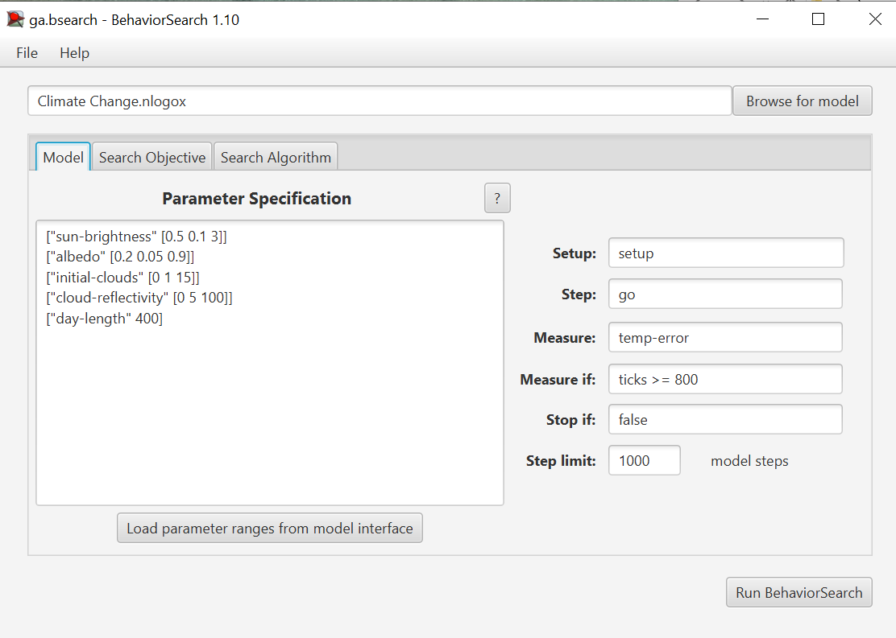
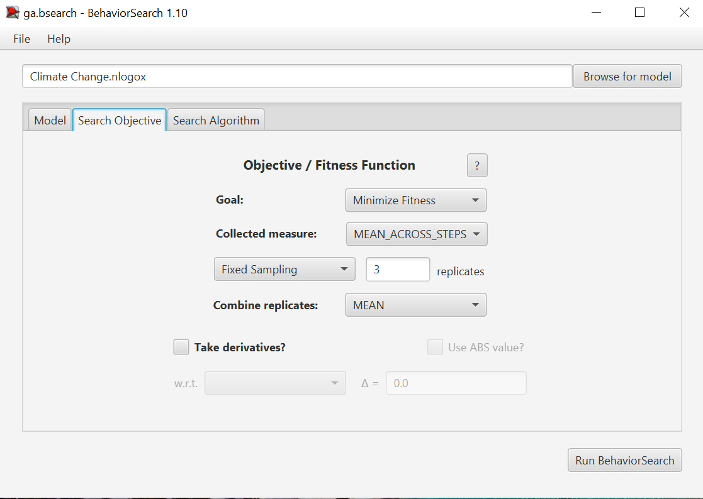
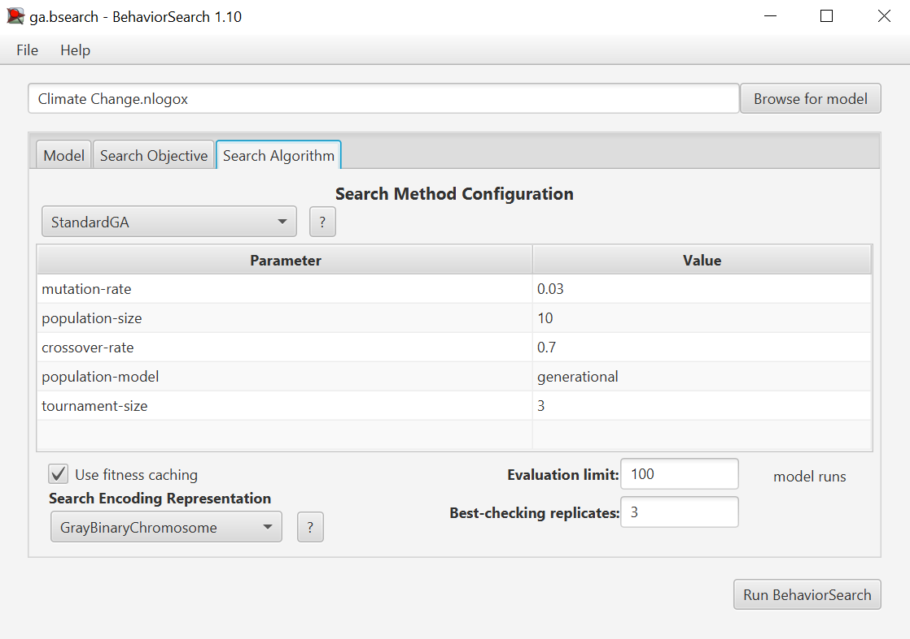
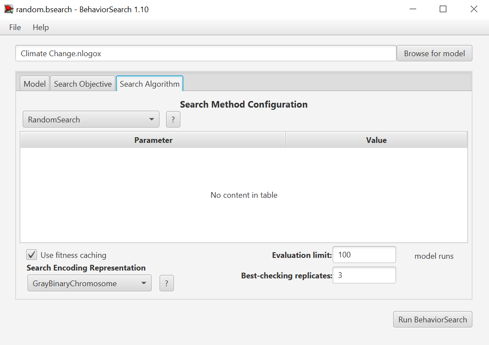
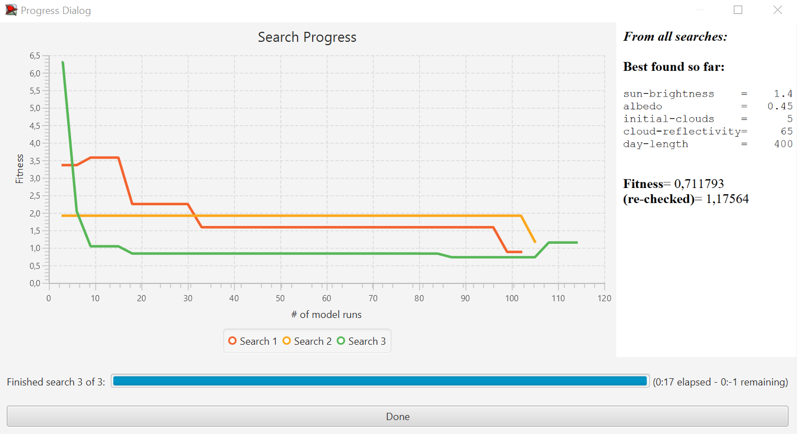
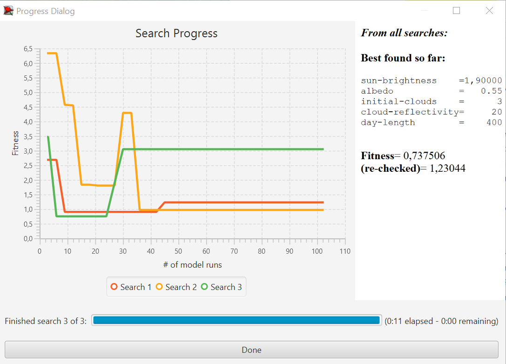
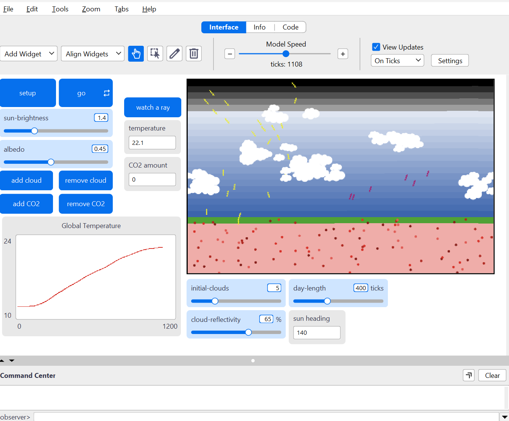

# Лабораторна робота 3

Тема: пошук параметрів моделі в BehaviorSearch

Студент: Бачинський Євген Олександрович, група СПм-25-1, варіант 2

## 1. Мета пошуку

Модель: Climate Change у версії з другої лабораторної (`Climate Change.nlogox`, NetLogo 7, BehaviorSearch 1.10).

Мета - підібрати параметри, при яких температура Землі через 800-1000 тактів наближається до 20 градусів. Показник - `temperature`. Цільова функція (мінімізується) - відстань від температури до цільового значення. Вона записана як окремий репортер моделі `temp-error` (BehaviorSearch не завжди бачить змінні моделі напряму, тому показник винесено в репортер):

```
to-report temp-error
  report abs (temperature - 20)
end
```

Вона вимірюється на кожному такті після 800-го (`ticks >= 800`) і усереднюється (MEAN_ACROSS_STEPS). Тобто оцінюється вже встановлена температура, а не розгін. Чим менше значення, тим ближча температура до 20. Для обох методів пошуку функція однакова.

## 2. Налаштування

Вкладка Model (параметри, показник, умови вимірювання):



Вкладка Search Objective (цільова функція):



Налаштування генетичного алгоритму:



Налаштування випадкового пошуку:



Керуючі параметри (простір пошуку):

| Параметр | Діапазон | Крок |
|---|---|---|
| sun-brightness | 0.5 - 3 | 0.1 |
| albedo | 0.2 - 0.9 | 0.05 |
| initial-clouds | 0 - 15 | 1 |
| cloud-reflectivity | 0 - 100 | 5 |

Сталий параметр: `day-length` = 400.

Метод 1: генетичний алгоритм (StandardGA): розмір популяції 10, mutation-rate 0.03, crossover-rate 0.7, tournament-size 3, generational, кодування GrayBinaryChromosome. Метод 2: випадковий пошук (RandomSearch).

| Налаштування | Значення |
|---|---|
| Evaluation limit | 100 запусків моделі |
| Повторів пошуку для кожного методу | 3 |
| Повторів моделі для однієї оцінки (fitness sampling) | 3 |
| Best-checking replicates | 3 |
| Кроків моделі (step limit) | 1000 |
| Stop if | false |

Файли налаштувань: `ga.bsearch`, `random.bsearch`. Результати пошуку (найкращі комбінації кожного запуску): `ga.finalBests.csv`, `ga.finalCheckedBests.csv`, `random.finalBests.csv`, `random.finalCheckedBests.csv`.

## 3. Результати

Найкраща комбінація кожного з трьох запусків (ціль - відстань до 20 градусів, менше - краще). Колонка «Перевірка» - значення, яке дав Best-checking (3 нових прогони з тими самими параметрами):

**Генетичний алгоритм**

| Запуск | sun-brightness | albedo | initial-clouds | cloud-reflectivity | Оцінок моделі | Ціль при пошуку | Перевірка |
|:-:|:-:|:-:|:-:|:-:|:-:|:-:|:-:|
| 1 | 1.9 | 0.65 | 4 | 30 | 102 | 0.906 | 0.882 |
| 2 | 1.4 | 0.45 | 5 | 65 | 105 | 0.712 | 1.176 |
| 3 | 2.7 | 0.75 | 0 | 10 | 114 | 0.901 | 1.151 |
| Середнє | | | | | | 0.840 | 1.070 |

**Випадковий пошук**

| Запуск | sun-brightness | albedo | initial-clouds | cloud-reflectivity | Оцінок моделі | Ціль при пошуку | Перевірка |
|:-:|:-:|:-:|:-:|:-:|:-:|:-:|:-:|
| 1 | 1.9 | 0.55 | 3 | 20 | 102 | 0.738 | 1.230 |
| 2 | 1.0 | 0.25 | 12 | 5 | 102 | 0.815 | 0.973 |
| 3 | 2.2 | 0.40 | 11 | 65 | 102 | 0.775 | 3.051 |
| Середнє | | | | | | 0.776 | 1.751 |

Графіки з BehaviorSearch (кожна лінія - один запуск пошуку). Генетичний алгоритм:



Випадковий пошук:



## 4. Перевірка знайдених параметрів

Для перевірки в NetLogo задано параметри найкращого розв'язку генетичного алгоритму (запуск 2): `sun-brightness` 1.4, `albedo` 0.45, `initial-clouds` 5, `cloud-reflectivity` 65, `day-length` 400. Після 1108 тактів температура 22.1 градуса, і крива вже майже вирівнялась:



## Висновки

Обидва методи знайшли параметри, при яких температура після 800-го такту відхиляється від 20 градусів приблизно на 0.7-0.9. Під час пошуку випадковий пошук мав трохи кращу середню ціль (0.78 проти 0.84), але перевірка показала, що в нього ця цифра випадкова: у запуску 3 вона виросла з 0.78 до 3.05. У генетичного алгоритму перевірка стабільніша (середнє 1.07 проти 1.75), тож його результати надійніші. Обидва методи вклались у 100 оцінок моделі. Вручну перевірене рішення дало 22.1 градуса на такті 1108, тобто біля 20 температура тримається не точно: цільова функція ніколи не стає нулем, і за межами тактів 800-1000 температура ще змінюється. Недолік методу: оцінка залежить від випадковості в моделі, тому з трьох повторів не завжди вдається знайти стабільну комбінацію.
